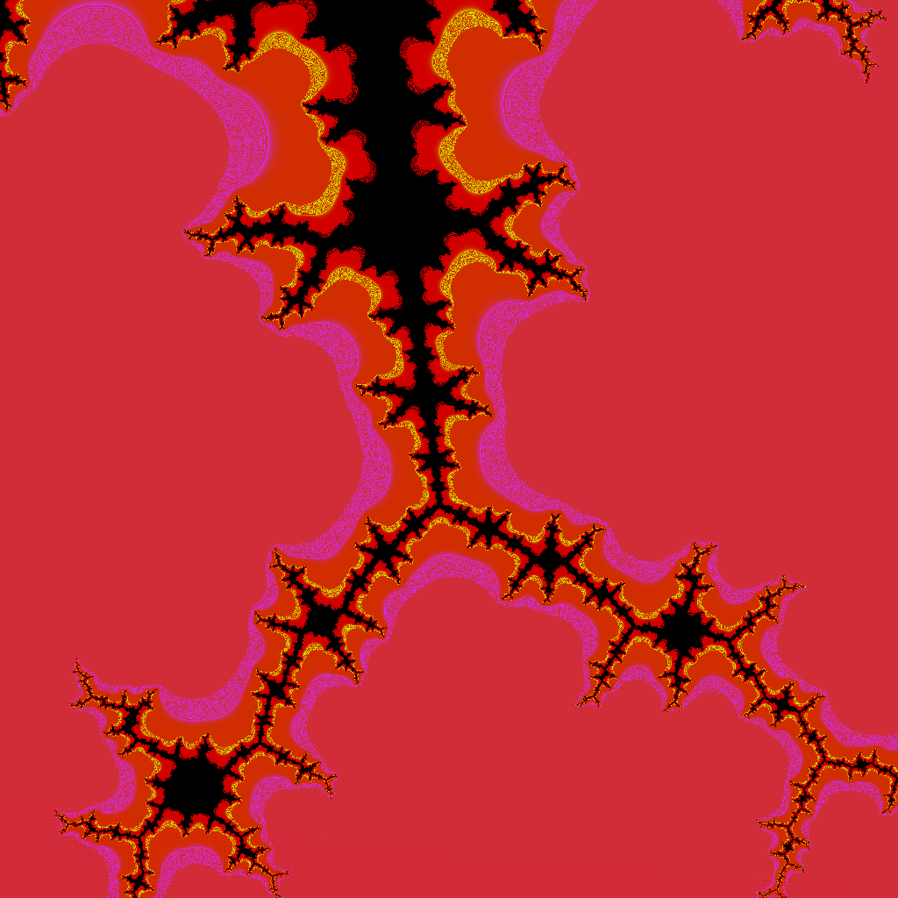
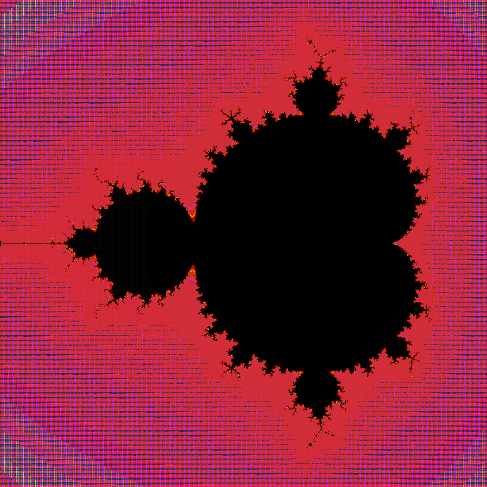
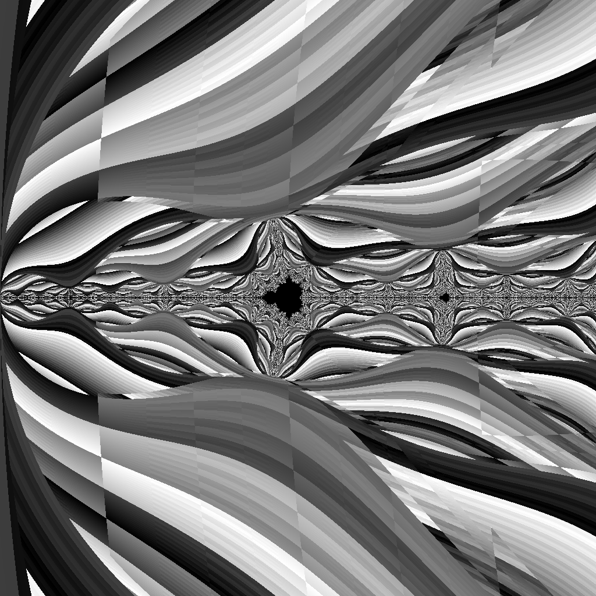

# Mandelbrot Image Generator
A *"blazingly"* fast, single-file C++ program that generates an image of the Mandelbrot set. Includes customizable color passes, multi-threaded rendering, and a simple raw bitmap output.





## Building


Use make to compile. Requires `g++` and `libquadmath`.

```bash
cd mandelbrot && make
```

## Usage

The output can be configured using many flags.

| flag | input-type | default | description |
| - | - | - | - |
| `-x` | double | `0.0` | Sets the x position of the center of the screen. (Real component) |
| `-y` | double | `0.0` | Sets the y position of the center of the screen. (Imaginary compnent) |
| `-s` | double | `1.0` | Sets the scale. Values between 0 and 1 zoom in. Values greater than 1 zoom out. |
| `-w` | int32 | `512` | Sets the horizontal resolution (width) of the output image |
| `-h` | int32 | `512` | Sets the vertical resolution (height) of the ouput image |
| `-r` | int32 | `512` | Sets both the horizontal and vertical resolution to the same input value |
| `-p` | int (0-255) | `40` | Sets the level of precision to use. See the note about precision below. |
| `-t` | int (0-255) | `2` | Sets the number of threads to use. |

Example:

```bash
./mandelbrot -x -1.0 -y 0.1 -s 0.1 -r 8196 -p 50 -t 32
```

### Precision

Using lower precision values can greatly increase rendering times, however its also LESS PRECISE! I have chosen 40 as the sweet-spot value as it is a balance of performance and precision.

Using values greater than 64 will swap the renderer to high precision mode. Instead of using `double`, everything uses `__float128`. This is extremely precise, but is hundreds of times slower. 

### Color customization

In the future I plan on changing this as its currently somewhat complicated.

## AI Use Disclaimer
Neither generative, nor agentic models were used to a significant degree in the creation of this project. All code was written by me, and all debugging was done by hand.
